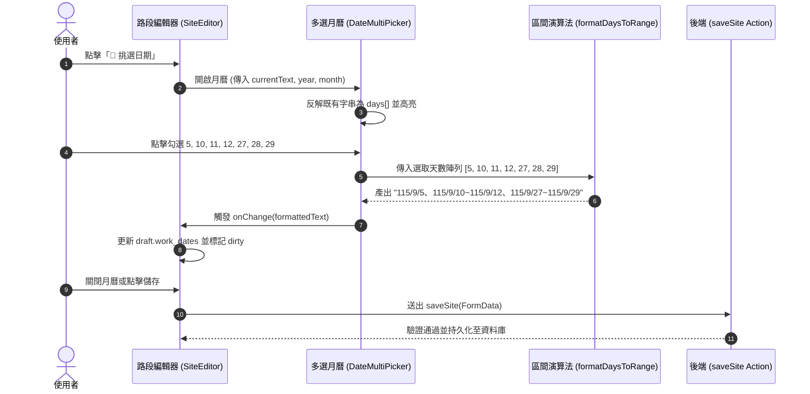

# 系統架構與狀態設計 (Architecture & State Flow)

## 一、 技術架構概覽

* **前端框架**：Next.js 16 (App Router)、React 19、TypeScript。
* **樣式標準**：純 CSS 原生模組與 CSS Variables，搭配既有 `legacy.css` 主題。
* **資料持久化**：Supabase PostgreSQL（透過 `saveSite` Server Action 寫入 `monthly_sites` 資料表）。
* **領域業務模組**：`web/lib/legacy-work-dates.ts`。

---

## 二、 元件架構與職責邊界

```
web/app/projects/[id]/sites/
├── page.tsx                     # 伺服器端頁面：載入標案、期程與路段資料
├── site-manager.tsx             # 客戶端管理器：路段列表排序與狀態彙總
├── editor.tsx                   # 路段行編輯器 (SiteEditor)
└── date-picker.tsx              # [新增] 多選月曆彈出元件 (DateMultiPicker)
```

* **`SiteEditor` (既有)**：
  * 管理單一路段的 `draft` 狀態（項次、路段名稱、施工日期、備註等）。
  * 監聽焦點失焦（`onBlur`）並透過 Server Action 自動提交變更。
* **`DateMultiPicker` (本次新增)**：
  * **純表現與互動層**：接收 `year`、`month`、`value` 與 `onChange`。
  * **封裝演算法**：內建「連續天數區間化」與「既有字串反解」邏輯。
  * **獨立視窗**：點擊按鈕開啟浮層，關閉時回寫至父表單。

---

## 三、 資料流與狀態流轉圖



---

## 四、 核心演算法規格

### 1. 連續天數合併演算法 (`formatDaysToRange`)

* **輸入**：
  * `year`: 民國年（例如 `115`）
  * `month`: 月份（`1~12`）
  * `days`: 日期數字陣列（例如 `[12, 5, 10, 11, 27, 29, 28]`）
* **演算法邏輯**：
  1. 去除重複並升序排序：`[5, 10, 11, 12, 27, 28, 29]`。
  2. 單趟線性分組：
     * 若 $D_{i} = D_{i-1} + 1$，則延展當前區間。
     * 若不連續，則將當前區間推入結果，並開啟新區間。
  3. 格式化輸出：
     * 若 $start = end$ ➔ `${year}/${month}/${start}`
     * 若 $start < end$ ➔ `${year}/${month}/${start}~${year}/${month}/${end}`
  4. 以頓號 `、` 串接各群組。
* **複雜度**：時間複雜度 $O(N \log N)$（$N \le 31$，微秒級完成），空間複雜度 $O(N)$。

### 2. 既有文字反向解析

* 利用 `web/lib/legacy-work-dates.ts` 內現成函式：
  `workDatesToDays(rawString, year + 1911, month)`
* 可直接將合規字串解析為日期的整數陣列（例如 `[5, 10, 11, 12]`），實現無縫反向勾選。
