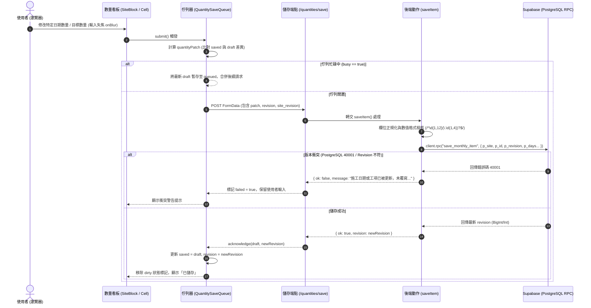
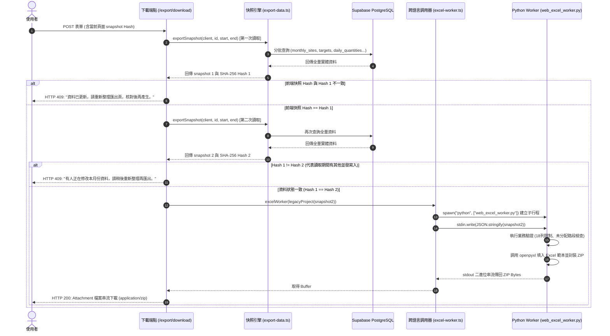

# 工程施工文件系統 (Construction Documents System) 逆向工程分析報告

> 本報告嚴格依據 `repomix-output.xml` 內之原始碼檔案事實進行逆向工程剖析，無推測或未出現在程式碼中的邏輯。

---

## 1. 資料表與實體清單 (Database & Tables)

專案後端採用 Supabase (PostgreSQL)，多數寫入行為透過資料庫預存程序 (RPC) 保障樂觀鎖與關聯一致性，讀取則透過 PostgREST Client 進行關聯查詢。

### 1.1 核心實體結構對照表

| 資料表名稱 (Table / View) | 欄位名稱 (Fields) | 型態 (Type) | 鍵值與約束 (PK / FK / Constraints) | 關聯性 (Relations) | 對應代碼檔案路徑 |
| :--- | :--- | :--- | :--- | :--- | :--- |
| **`organizations`** | `id`<br>`name` | `uuid`<br>`text` | **PK**: `id` | 1:N 關聯至 `projects`<br>1:N 關聯至 `organization_members` | `web/app/projects/page.tsx` |
| **`organization_members`** | `org_id`<br>`user_id`<br>`role` | `uuid`<br>`uuid`<br>`text` | **FK**: `org_id` $\to$ `organizations.id`<br>**FK**: `user_id` $\to$ `auth.users.id` | 檢查使用者組織成員權限 (RBAC) | `web/app/projects/page.tsx`<br>`web/app/projects/[id]/page.tsx` |
| **`projects`** | `id`<br>`org_id`<br>`code`<br>`name`<br>`kind`<br>`owner`<br>`contractor`<br>`supervisor`<br>`location`<br>`contract_amount`<br>`revision`<br>`archived_at` | `uuid`<br>`uuid`<br>`text`<br>`text`<br>`text`<br>`text`<br>`text`<br>`text`<br>`text`<br>`numeric`<br>`bigint / integer`<br>`timestamp with time zone` | **PK**: `id`<br>**FK**: `org_id` $\to$ `organizations.id`<br>**Unique**: `(org_id, code)`<br>**Check**: `kind IN ('park', 'rainwater')`<br>**Check**: `revision >= 1` | 1:N 關聯至 `reporting_periods`<br>1:N 關聯至 `work_orders`<br>1:N 關聯至 `project_members`<br>1:N 關聯至 `contract_versions` | `web/app/projects/actions.ts`<br>`web/lib/export-data.ts`<br>`web/app/projects/[id]/sites/actions.ts` |
| **`project_members`** | `project_id`<br>`user_id`<br>`role` | `uuid`<br>`uuid`<br>`text` | **FK**: `project_id` $\to$ `projects.id`<br>**FK**: `user_id` $\to$ `auth.users.id` | 檢查使用者標案操作權限 | `web/app/projects/[id]/page.tsx`<br>`web/app/projects/[id]/sites/page.tsx` |
| **`project_settings_view`** *(View)* | `id`<br>`name`<br>`owner`<br>`contractor`<br>`supervisor`<br>`location`<br>`contract_amount`<br>`revision` | `uuid`<br>`text`<br>`text`<br>`text`<br>`text`<br>`text`<br>`numeric`<br>`bigint` | 映射自 `projects` 表的唯讀/設定視圖 | 標案設定檢視 | `web/app/projects/[id]/page.tsx` |
| **`reporting_periods`** | `id`<br>`project_id`<br>`roc_year`<br>`month`<br>`period_start`<br>`period_end`<br>`closed_at` | `uuid`<br>`uuid`<br>`integer`<br>`integer`<br>`date`<br>`date`<br>`timestamp with time zone` | **PK**: `id`<br>**FK**: `project_id` $\to$ `projects.id`<br>**Unique**: `(project_id, period_start)`<br>**Check**: `month BETWEEN 1 AND 12` | 1:N 關聯至 `monthly_sites`<br>1:N 關聯至 `item_period_targets`<br>1:N 關聯至 `opening_balances` | `web/lib/export-data.ts`<br>`web/app/projects/[id]/prior/actions.ts` |
| **`monthly_sites`** | `id`<br>`project_id`<br>`period_id`<br>`item_number`<br>`name`<br>`work_dates`<br>`note`<br>`case_override`<br>`revision`<br>`display_order` | `uuid`<br>`uuid`<br>`uuid`<br>`integer`<br>`text`<br>`text`<br>`text`<br>`text`<br>`integer`<br>`integer` | **PK**: `id`<br>**FK**: `project_id` $\to$ `projects.id`<br>**FK**: `period_id` $\to$ `reporting_periods.id`<br>**Unique**: `(period_id, item_number)`<br>**Check**: `case_override IN ('normal', 'independent')` | 1:N 關聯至 `item_period_targets`<br>1:1 / 1:N 與派工單路段映射 | `web/app/projects/[id]/sites/actions.ts`<br>`web/lib/export-data.ts`<br>`specs/001-quantities-work-dates-sync/data-model.md` |
| **`work_orders`** | `id`<br>`project_id`<br>`number`<br>`title`<br>`issued_on`<br>`due_on`<br>`status`<br>`case_override`<br>`revision` | `uuid`<br>`uuid`<br>`text`<br>`text`<br>`date`<br>`date`<br>`text`<br>`text`<br>`integer` | **PK**: `id`<br>**FK**: `project_id` $\to$ `projects.id`<br>**Unique**: `(project_id, number)`<br>**Check**: `status IN ('draft', 'active', 'closed')`<br>**Check**: `due_on >= issued_on` | 1:N 關聯至 `work_order_items`<br>可透過 `assign_work_order_to_month` 指派至月路段 | `web/app/projects/[id]/work-orders/actions.ts`<br>`web/app/projects/[id]/work-orders/page.tsx` |
| **`contract_items`** | `code`<br>`name`<br>`unit`<br>`price`<br>`kind` | `text`<br>`text`<br>`text`<br>`numeric`<br>`text` | **PK**: `code`<br>**Check**: `kind IN ('park', 'rainwater')` | 基礎工項目錄與單價對照 | `web/lib/export-data.ts`<br>`web/lib/legacy-catalog.json` |
| **`work_order_items`** | `id`<br>`work_order_site_id`<br>`contract_item_code` | `uuid`<br>`uuid`<br>`text` | **PK**: `id`<br>**FK**: `contract_item_code` $\to$ `contract_items.code` | 派工路段與合約工項中繼關聯 | `web/lib/export-data.ts` |
| **`item_period_targets`** | `id`<br>`project_id`<br>`period_id`<br>`site_id`<br>`work_order_item_id`<br>`target_quantity`<br>`note`<br>`revision` | `uuid`<br>`uuid`<br>`uuid`<br>`uuid`<br>`uuid`<br>`numeric(12, 4)`<br>`text`<br>`integer` | **PK**: `id`<br>**FK**: `project_id` $\to$ `projects.id`<br>**FK**: `period_id` $\to$ `reporting_periods.id`<br>**FK**: `site_id` $\to$ `monthly_sites.id`<br>**FK**: `work_order_item_id` $\to$ `work_order_items.id` | 1:N 關聯至 `daily_quantities` | `web/app/projects/[id]/quantities/actions.ts`<br>`web/lib/export-data.ts` |
| **`daily_quantities`** | `id`<br>`project_id`<br>`target_id`<br>`work_date`<br>`quantity` | `uuid`<br>`uuid`<br>`uuid`<br>`date`<br>`numeric(12, 4)` | **PK**: `id`<br>**FK**: `project_id` $\to$ `projects.id`<br>**FK**: `target_id` $\to$ `item_period_targets.id`<br>**Unique**: `(target_id, work_date)` | 記錄當月單一路段工項在特定日期的實際施作數量 | `web/lib/export-data.ts`<br>`web/app/projects/[id]/quantities/actions.ts` |
| **`opening_balances`** | `id`<br>`project_id`<br>`period_id`<br>`contract_item_code`<br>`as_of_date`<br>`quantity`<br>`revision` | `uuid`<br>`uuid`<br>`uuid`<br>`text`<br>`date`<br>`numeric(16, 6)`<br>`integer` | **PK**: `id`<br>**FK**: `project_id` $\to$ `projects.id`<br>**FK**: `period_id` $\to$ `reporting_periods.id`<br>**FK**: `contract_item_code` $\to$ `contract_items.code` | 記錄截至該期程前一日的前期累計施作量 | `web/app/projects/[id]/prior/actions.ts`<br>`web/lib/export-data.ts` |
| **`contract_versions`** | `id`<br>`project_id`<br>`label`<br>`amount`<br>`effective_date` | `uuid`<br>`uuid`<br>`text`<br>`numeric`<br>`date` | **PK**: `id`<br>**FK**: `project_id` $\to$ `projects.id` | 記錄標案契約金額變更歷程 | `web/lib/export-data.ts` |

---

## 2. 核心函式與進入點清單 (Functions & Endpoints)

系統入口分為 **Next.js App Router API 路由 (`route.ts`)** 與 **伺服器動作 (Server Actions, `actions.ts`)**，另由後端內部模組負責資料匯出與 Python Worker 行程調用。

### 2.1 API 路由 (Route Handlers)

| 檔案路徑 | 進入點 / HTTP Method | 輸入參數與型態 | 回傳格式 | 操作資料表與 CRUD 行為 |
| :--- | :--- | :--- | :--- | :--- |
| `web/app/download/[key]/route.ts` | `GET` | `params: { key: string }` (`log` \| `settlement` \| `json`) | `Binary (xlsx / json)` | **None (無 DB 操作)**<br>讀取本機 `.local-data/` 靜態檔案，供 `local-preview` 模式比對校驗。 |
| `web/app/projects/[id]/export/download/route.ts` | `POST` | `params: { id: string }`<br>`FormData: { year, month, snapshot }` | `application/zip` (ZIP 檔二進位串流) 或 `JSON { message }` | **R**: `projects`, `reporting_periods`, `monthly_sites`, `item_period_targets`, `daily_quantities`, `opening_balances`, `contract_versions`<br>進行雙重快照比對後送入 Python Worker 產出 Excel。 |
| `web/app/projects/[id]/quantities/save/route.ts` | `POST` | `FormData`: `site`, `id`, `revision`, `site_revision`, `target`, `note`, `day:*`, `operation` | `JSON { ok: boolean, message: string, revision?: number }` | **R/U/D**: 委派至 `saveItem()` 執行同源檢查與 RPC `save_monthly_item`。 |

### 2.2 伺服器動作 (Server Actions)

| 檔案路徑 | 函式名稱 | 輸入參數與型態 | 回傳格式 | 操作資料表與 CRUD 行為 |
| :--- | :--- | :--- | :--- | :--- |
| `web/app/login/actions.ts` | `login` | `previous: LoginState`<br>`form: FormData` (`email`, `password`) | `Promise<LoginState>` (成功時 redirect) | **R/Auth**: 呼叫 Supabase Auth `signInWithPassword` 建立 Session。 |
| `web/app/login/actions.ts` | `logout` | 無 | `Promise<void>` (redirect `/login`) | **Auth**: 呼叫 Supabase Auth `signOut({ scope: "local" })`。 |
| `web/app/projects/actions.ts` | `createProject` | `_previous: FormState`<br>`form: FormData` (`org_id`, `code`, `name`, `kind`) | `Promise<FormState>` (成功時 redirect) | **C**: 呼叫 RPC `create_project`<br>建立 `projects` 記錄並建立預設期程/權限。 |
| `web/app/projects/actions.ts` | `saveSettings` | `previous: FormState`<br>`form: FormData` (`id`, `revision`, `name`, `owner`, `contractor`, `supervisor`, `location`, `amount`) | `Promise<FormState>` | **U**: 呼叫 RPC `save_project_settings`<br>帶入 `p_revision` 樂觀鎖更新 `projects` 基本屬性。 |
| `web/app/projects/[id]/sites/actions.ts` | `reorderSites` | `project: string`<br>`year: number`<br>`month: number`<br>`expected: string[]`<br>`ordered: string[]` | `Promise<{ message: string }>` | **U**: 呼叫 RPC `reorder_monthly_sites`<br>批次更新 `monthly_sites.display_order` 與項次。 |
| `web/app/projects/[id]/sites/actions.ts` | `saveSite` | `previous: SiteState`<br>`form: FormData` (`project`, `id`, `revision`, `item_number`, `year`, `month`, `name`, `work_dates`, `note`, `case_override`) | `Promise<SiteState>` | **R**: 查詢 `projects.kind`<br>**C/U**: 呼叫 RPC `save_monthly_site`<br>驗證日期間隔後新增或依 `revision` 樂觀更新 `monthly_sites`。 |
| `web/app/projects/[id]/sites/actions.ts` | `assignOrder` | `previous: { message: string, ok?: boolean }`<br>`form: FormData` (`project`, `order`, `revision`, `year`, `month`, `work_dates`) | `Promise<{ message: string, ok?: boolean }>` | **R**: 查詢 `projects.kind`<br>**C/U**: 呼叫 RPC `assign_work_order_to_month`<br>將 `work_orders` 關聯轉換並寫入 `monthly_sites`。 |
| `web/app/projects/[id]/work-orders/actions.ts` | `saveOrder` | `previous: OrderState`<br>`form: FormData` (`project`, `id`, `revision`, `number`, `title`, `status`, `case_override`, `issued_on`, `due_on`) | `Promise<OrderState>` | **C/U**: 呼叫 RPC `save_work_order`<br>校驗起迄日合法性後新增或依 `revision` 更新 `work_orders`。 |
| `web/app/projects/[id]/quantities/actions.ts` | `addItem` | `previous: QuantityState`<br>`form: FormData` (`site`, `code`) | `Promise<QuantityState>` | **R**: 查詢 `monthly_sites.project_id` 與 `projects.kind`<br>**C**: 呼叫 RPC `add_monthly_item`，載入 `legacy-catalog.json` 建立 `item_period_targets`。 |
| `web/app/projects/[id]/quantities/actions.ts` | `saveItem` | `previous: QuantityState`<br>`form: FormData` (`site`, `id`, `revision`, `site_revision`, `target`, `note`, `day:*`, `operation`) | `Promise<QuantityState>` | **R**: 若缺省略值則讀取 `item_period_targets`<br>**U/D**: 呼叫 RPC `save_monthly_item`，更新 `item_period_targets`、批次覆寫 `daily_quantities` 或執行軟刪除 (`p_remove`)。 |
| `web/app/projects/[id]/prior/actions.ts` | `savePrior` | `previous: PriorState`<br>`form: FormData` (`period`, `revision`, `codes`, `quantities`) | `Promise<PriorState>` | **R**: 查詢 `reporting_periods` 與 `projects.kind`<br>**U/C**: 呼叫 RPC `save_prior_balances`<br>解析剪貼簿矩陣後批次更新 `opening_balances`。 |

### 2.3 核心服務與背景 Worker 進入點

| 檔案路徑 | 函式名稱 | 輸入參數與型態 | 回傳格式 | 功能與操作行為 |
| :--- | :--- | :--- | :--- | :--- |
| `web/lib/export-data.ts` | `exportSnapshot` | `client: SupabaseClient`<br>`projectId: string`<br>`start: string`<br>`end: string` | `Promise<{ snapshot: object, hash: string }>` | 分頁批次（每批 500 筆）取出該標案月份所有路段、工項目標、每日數量與前期餘額，計算整體 SHA-256 雜湊。 |
| `web/lib/excel-worker.ts` | `excelWorker` | `project: any` (標準化快照物件) | `Promise<Buffer>` (ZIP 二進位資料) | 透過 `child_process.spawn` 啟動 Python Worker，經由 `stdin` 傳入 JSON，從 `stdout` 接收產生之 Excel ZIP 檔。 |
| `migration_tools/web_excel_worker.py` | `generate` | `data: dict` (自 `sys.stdin` 讀取之 JSON 快照) | `bytes` (ZIP 二進位流) | 呼叫原始 `baselines` 模組中的 `export_log_only` 與 `export_settlement_for_sites`，利用 `openpyxl` 產出施工日誌與結算報表。 |
| `web/lib/quantity-save-queue.ts` | `QuantitySaveQueue.submit` | `remove = false`<br>`force = false` | `Promise<void>` | 前端按行維護的佇列管理器。計算 `quantityPatch` 差異量，向後端發送更新，成功後才遞增行版本號 (`revision`)。 |

---

## 3. 系統架構與資料流 (Architecture)

### 3.1 數量即時編輯與樂觀鎖保存資料流 (Mermaid 循序圖)

此圖展示使用者在前端數量看板 (Quantity Board) 編輯數據時，透過前端差量佇列 (`QuantitySaveQueue`) 搭配後端樂觀版本號進行並發控制的完整流程：



---

### 3.2 報表匯出雙重快照與跨語言調用流程 (Mermaid 循序圖)

此圖呈現報表匯出時為防止讀寫衝突所採取的 **Double-Read Hash Verification (雙重快照校驗)**，以及 Node.js 與 Python 行程之間的資料傳遞：



---

## 4. 代碼事實中的技術債與強耦合風險點分析

### 4.1 行程級跨語言強耦合 (IPC via Child Process)
* **代碼事實**：`web/lib/excel-worker.ts` 第 14 行直接呼叫 `spawn(python, [worker])`，依賴本機作業系統必須安裝 Python 且具備 `openpyxl` 套件，並在第 6 行顯式宣告 `if (process.env.VERCEL) throw Error("文件服務尚未部署。");`。
* **風險與影響**：
  * **容器與環境鎖定**：無法直接在標準 Serverless 雲端平台（如 Vercel Edge / Functions）執行，必須以 Docker 容器多階段建置方式（同時包含 Node.js 與 Python）維護。
  * **行程消耗與記憶體洩漏**：每次匯出請求均會啟動一個獨立 Python 行程，高並發下載時將迅速耗盡伺服器 CPU 與 Process Table，存在 DoS 風險。

### 4.2 報表列數硬編碼限制 (Hardcoded 18 Rows Limit)
* **代碼事實**：`migration_tools/web_excel_worker.py` 第 30~31 行硬編碼限制：
  ```python
  if (kind.id == 'rainwater' and len(normal) > 18) or (kind.id == 'park' and len(project.sites) > 18):
      raise ValueError('本次路段超過原範本 18 列，需先確認分頁方式，避免漏列。')
  ```
* **風險與影響**：
  * **業務阻斷**：當單一工程標案在單月份的路段數超過 18 筆時，匯出功能將直接拋出錯誤並中斷，無動態分頁或範本擴展機制。

### 4.3 雙重快照樂觀檢查的併發盲區 (Time-of-Check to Time-of-Use, TOCTOU)
* **代碼事實**：`web/app/projects/[id]/export/download/route.ts` 第 38~49 行透過連續執行兩次 `exportSnapshot` 計算 SHA-256 比對一致性。
* **風險與影響**：
  * 此機制為應用層模擬的一致性讀取，並未在 PostgreSQL 啟用真正的可序列化交易隔離層 (`SERIALIZABLE` Transaction Isolation)。
  * 在第二次讀取完成後到 Python Worker 產出 Excel 的這段時間內，若有寫入動作，匯出的 Excel 內容依然可能包含不一致的狀態。

### 4.4 資料庫型態與客戶端型態分散維護 (Split Source of Truth)
* **代碼事實**：
  * 前端手動在 `web/lib/types.ts` 定義 `Site`, `Record`, `Total`, `Snapshot`。
  * 後端在 PostgreSQL 透過 RPC 運算（如 `save_monthly_item`, `create_project`）。
  * Python Worker 在 `baselines/20260920T151632Z/source/app/models.py` 另以 Python `dataclass` 定義 `Project`, `Site`, `Quantity`。
* **風險與影響**：
  * 未使用 Supabase CLI 自動從 DB Schema 產出 TypeScript 型別定義。
  * 任何資料表結構調整，需同步手動修改 TypeScript、PostgreSQL RPC 與 Python Dataclass，極易引發欄位不對齊錯誤。

### 4.5 業務邏輯深陷資料庫預存程序 (Database Stored Procedure Lock-in)
* **代碼事實**：全系統的核心邏輯（包含項次重新編號、日期間隔格式校驗、關閉狀態判定、版本遞增 `revision + 1`、歷史前期量計算等）全數封裝於 PostgreSQL RPC 內（如 `save_monthly_item`, `reorder_monthly_sites`, `save_prior_balances`）。
* **風險與影響**：
  * 專案儲存庫中未見 SQL 原始遷移檔（Migration scripts）版本化管理，造成邏輯黑箱。
  * 業務單元測試困難，無法在純前端或無連線狀態下單獨對業務規則進行單元測試（需依賴 Mock 或連線至真實 Supabase 實例）。


---

## 5. 前端 UI 頁面與表單元件索引地圖 (Next.js App Router & Component Mapping)

本章節建立 Next.js 前端畫面元件與後端處理器、表單 Input 欄位名稱（`name`）、提交之 Server Action / API Route 以及後端 PostgreSQL RPC 的快速反查索引。

```
Next.js 路由架構樹：
web/app/
 ├── login/ (登入驗證)
 ├── projects/ (標案清單與建立)
 └── projects/[id]/ (單一標案工作區)
      ├── page.tsx (標案基本設定視圖與表單)
      ├── sites/ (施工路段管理與日期連動)
      ├── quantities/ (數量看板、每日數量即時差量編輯)
      ├── prior/ (前期累計剪貼簿編輯器)
      ├── export/ (雙重快照核對與報表下載)
      └── work-orders/ (派工單新增與維護)
```

---

### 5.1 身份驗證模組 (Login)
* **路由位置**：`/login`
* **畫面檔案**：`web/app/login/page.tsx`、`web/app/login/form.tsx`
* **後端動作**：`web/app/login/actions.ts:login`

| 畫面控制項標籤 (Label) | 控制項類型 | Form Input `name` | 提交之 Action / API | 後端 Supabase 操作 | 說明 |
| :--- | :--- | :--- | :--- | :--- | :--- |
| **電子信箱** | `<input type="email">` | `email` | `login(previous, formData)` | `supabase.auth.signInWithPassword` | 登入帳號 |
| **密碼** | `<input type="password">` | `password` | `login(previous, formData)` | `supabase.auth.signInWithPassword` | 登入密碼 |
| **登入** | `<button type="submit">` | - | `login(previous, formData)` | 建立 Session Cookie | 成功後導向 `/projects` |

---

### 5.2 專案總覽與建立標案 (Projects List & Create)
* **路由位置**：`/projects`
* **畫面檔案**：`web/app/projects/page.tsx`、`web/app/projects/forms.tsx`
* **後端動作**：`web/app/projects/actions.ts:createProject`

| 畫面控制項標籤 (Label) | 控制項類型 | Form Input `name` | 提交之 Action / API | 後端 Supabase 操作 / RPC | 說明 |
| :--- | :--- | :--- | :--- | :--- | :--- |
| **所屬組織** | `<input type="hidden">` | `org_id` | `createProject` | 寫入 `projects.org_id` | 預設填入使用者所屬組織 ID |
| **標案代碼** | `<input type="text">` | `code` | `createProject` | RPC `create_project(p_code)` | 唯一鍵值（如 `115-PARK-01`） |
| **標案名稱** | `<input type="text">` | `name` | `createProject` | RPC `create_project(p_name)` | 工程名稱全名 |
| **工程類別** | `<select>` | `kind` | `createProject` | RPC `create_project(p_kind)` | 選項：`park`（公園）、`rainwater`（雨水） |
| **建立標案** | `<button type="submit">` | - | `createProject` | 呼叫 RPC 建立專案與初始期程 | 建立完成後自動導向 `/[id]` |

---

### 5.3 標案基本設定 (Project Settings)
* **路由位置**：`/projects/[id]`
* **畫面檔案**：`web/app/projects/[id]/page.tsx`、`web/app/projects/[id]/forms.tsx`
* **後端動作**：`web/app/projects/actions.ts:saveSettings`

| 畫面控制項標籤 (Label) | 控制項類型 | Form Input `name` | 提交之 Action / API | 後端 Supabase 操作 / RPC | 說明與約束 |
| :--- | :--- | :--- | :--- | :--- | :--- |
| **標案 ID** | `<input type="hidden">` | `id` | `saveSettings` | `projects.id` | 標案 UUID |
| **樂觀鎖版本號** | `<input type="hidden">` | `revision` | `saveSettings` | RPC `save_project_settings(p_revision)` | 樂觀並發版本號，防多人覆蓋 |
| **標案名稱** | `<input type="text">` | `name` | `saveSettings` | `projects.name` | 標案名稱 |
| **主辦機關** | `<input type="text">` | `owner` | `saveSettings` | `projects.owner` | 預設「新北市中和區公所」 |
| **承造廠商** | `<input type="text">` | `contractor` | `saveSettings` | `projects.contractor` | 預設「皇喆營造工程有限公司」 |
| **監造單位** | `<input type="text">` | `supervisor` | `saveSettings` | `projects.supervisor` | 監造技術顧問單位 |
| **施工地點** | `<input type="text">` | `location` | `saveSettings` | `projects.location` | 施工區域範圍 |
| **契約金額** | `<input type="number">` | `amount` | `saveSettings` | `projects.contract_amount` | 契約核定直接工程費/總額 |
| **儲存設定** | `<button type="submit">` | - | `saveSettings` | 呼叫 RPC 驗證並更新標案設定 | 成功後刷新頁面視圖 |

---

### 5.4 施工路段管理 (Site Management)
* **路由位置**：`/projects/[id]/sites`
* **畫面檔案**：`web/app/projects/[id]/sites/page.tsx`、`editor.tsx`、`site-manager.tsx`、`date-picker.tsx`、`assign-order.tsx`
* **後端動作**：`web/app/projects/[id]/sites/actions.ts:saveSite`、`reorderSites`、`assignOrder`

| 畫面控制項標籤 (Label) | 控制項類型 | Form Input `name` | 提交之 Action / API | 後端 Supabase 操作 / RPC | 說明與限制 |
| :--- | :--- | :--- | :--- | :--- | :--- |
| **項次 (路段編號)** | `<input type="number">` | `item_number` | `saveSite` | RPC `save_monthly_site(p_item_number)` | 月份內路段項次編號 |
| **路段名稱** | `<input type="text">` | `name` | `saveSite` | RPC `save_monthly_site(p_name)` | 路段或派工地標名稱 |
| **施工日期區間** | `<input type="text">` | `work_dates` | `saveSite` | RPC `save_monthly_site(p_work_dates)` | 格式如 `115/6/1-115/6/2`，帶檢核防呆 |
| **日期選取器** | 客製元件 (`DatePicker`) | 連動 `work_dates` | Client-side 互動 | 自動轉換為民國格式字串 | 提供月曆點選以填入合法日期格式 |
| **路段備註** | `<input type="text">` | `note` | `saveSite` | RPC `save_monthly_site(p_note)` | 單一路段備註說明 |
| **案件類別** | `<select>` | `case_override` | `saveSite` | RPC `save_monthly_site(p_case_override)`| 值域：`""`、`normal`、`independent` |
| **上移 / 下移 (排序)**| `<button>` | - | `reorderSites` | RPC `reorder_monthly_sites` | 批次更新 `display_order` 與項次 |
| **指派派工單** | Modal 表單 | `order` 等 | `assignOrder` | RPC `assign_work_order_to_month` | 將未結派工單匯入該月份路段 |

---

### 5.5 數量看板與即時編輯 (Quantities Board)
* **路由位置**：`/projects/[id]/quantities`
* **畫面檔案**：`web/app/projects/[id]/quantities/page.tsx`、`board.tsx`
* **後端處理**：`web/app/projects/[id]/quantities/actions.ts:saveItem`、`addItem` 及路由端點 `save/route.ts`

| 畫面控制項標籤 (Label) | 控制項類型 | Form Input / Key | 提交之 Action / API | 後端 Supabase 操作 / RPC | 說明與機制 |
| :--- | :--- | :--- | :--- | :--- | :--- |
| **加入工項** | `<select>` + `<button>` | `site`, `code` | `addItem` | RPC `add_monthly_item` | 依合約目錄建立 `item_period_targets` |
| **本月目標數量** | `<input type="number">` | `target` | `save/route.ts` ➔ `saveItem` | RPC `save_monthly_item(p_target)` | 當月工項施作數量上限 |
| **工項算式/備註** | `<textarea>` | `note` | `save/route.ts` ➔ `saveItem` | RPC `save_monthly_item(p_note)` | 填寫尺寸算式，供報表分析欄位套印 |
| **每日數量儲存格 (1~31日)**| 客製元件 (`Cell`) | `day:{n}` | `QuantitySaveQueue.submit()` ➔ `save/route.ts` | RPC `save_monthly_item(p_days)` | 透過前端差量佇列非同步發送更新 |
| **移除工項** | `<button>` | `operation="remove"`| `save/route.ts` ➔ `saveItem` | RPC `save_monthly_item(p_remove=true)` | 刪除工項並連帶移除每日數量 |

---

### 5.6 前期累計編輯器 (Prior Balances)
* **路由位置**：`/projects/[id]/prior`
* **畫面檔案**：`web/app/projects/[id]/prior/page.tsx`、`editor.tsx`
* **後端動作**：`web/app/projects/[id]/prior/actions.ts:savePrior`

| 畫面控制項標籤 (Label) | 控制項類型 | Form Input `name` | 提交之 Action / API | 後端 Supabase 操作 / RPC | 說明 |
| :--- | :--- | :--- | :--- | :--- | :--- |
| **前期代碼剪貼簿** | `<textarea>` | `codes` | `savePrior` | RPC `save_prior_balances` | 自 Excel 整欄複製貼上之工項代碼 |
| **前期數量剪貼簿** | `<textarea>` | `quantities` | `savePrior` | RPC `save_prior_balances` | 自 Excel 整欄複製貼上之前期完成數量 |
| **套用前期累計並儲存** | `<button type="submit">` | - | `savePrior` | 批次更新 `opening_balances` | 自動核對欄位長度並產生差額預覽 |

---

### 5.7 報表匯出與快照下載 (Export)
* **路由位置**：`/projects/[id]/export`
* **畫面檔案**：`web/app/projects/[id]/export/page.tsx`、`form.tsx`
* **後端處理**：`web/app/projects/[id]/export/download/route.ts`、`web/lib/excel-worker.ts`

| 畫面控制項標籤 (Label) | 控制項類型 | Form Input `name` | 提交之 Action / API | 後端處理與 Worker | 說明 |
| :--- | :--- | :--- | :--- | :--- | :--- |
| **當前快照雜湊** | `<input type="hidden">` | `snapshot` | `POST /export/download` | 比對雙重讀取 Hash | 防止讀取與匯出期間資料被他人修改 |
| **申報年份** | `<input type="hidden">` | `year` | `POST /export/download` | 傳送至 `exportSnapshot` | 申報民國年 |
| **申報月份** | `<input type="hidden">` | `month` | `POST /export/download` | 傳送至 `exportSnapshot` | 申報月份 |
| **產生並下載 Excel** | `<button type="submit">` | - | `POST /export/download` | 調用 Python 子行程產檔 | 成功時直接回傳 ZIP 二進位檔案下載 |

---

## 6. 前端狀態管理與差量儲存機制 (State Management & Save Queue)

為解決早期版本在多人同時編輯同一月份表格時的互相覆寫問題，Next.js 版本引進了 **按工項行獨立維護的前端佇列系統 (`QuantitySaveQueue`)** 與 **雙層版本號樂觀鎖機制**。

### 6.1 前端差量佇列 (`QuantitySaveQueue`) 運作原理

1. **記憶體狀態結構**：
   * `saved`：代表伺服器已確認寫入的資料快照。
   * `draft`：使用者當前在畫面上編輯的最新數值。
   * `queued`：當前景端正在發送網路請求時，若使用者又輸入新數字，新數字會暫存於 `queued`。
   * `busy`：布林值，標記當前此行是否正在執行 HTTP 傳輸。
2. **差量補丁發送 (`quantityPatch`)**：
   * 使用者在任一格子輸入完畢失焦（`onBlur`）時，佇列器比對 `draft` 與 `saved`：
   ```typescript
   // 僅抽出數值有變動的日期格子，不發送全月 31 天的全部數據
   const patch: Record<number, number> = {};
   for (const [day, qty] of Object.entries(draft.days)) {
     if (saved.days[day] !== qty) patch[Number(day)] = qty;
   }
   ```
3. **雙版本號防並發踩踏 (Dual Revisions)**：
   * 每次請求均攜帶兩個樂觀鎖：
     * `revision`：該工項行（`item_period_targets`）的目前版本號。
     * `site_revision`：所屬路段（`monthly_sites`）的目前版本號（防止路段施工日期剛好被其他人修改）。
   * 資料庫端於 RPC `save_monthly_item` 內部校驗版本，若不符則拒絕寫入並丟出 PostgreSQL 例外 `40001`。

---

## 7. 三向追溯表 (Next.js UI Input ➔ Supabase DB Schema ➔ Python Worker / Excel)

| 畫面功能 / 欄位 | Next.js 表單 Input | Supabase 資料表與欄位 | Python Worker 快照欄位 | Excel 範本最終位置 |
| :--- | :--- | :--- | :--- | :--- |
| **標案工程名稱** | `forms.tsx: name` | `projects.name` | `project.project_name` | `結算單封面!A2`、`施工日誌!A2` |
| **主辦機關單位** | `forms.tsx: owner` | `projects.owner` | `project.owner` | `結算單封面!A1`、`施工日誌!B3` |
| **契約核定金額** | `forms.tsx: amount` | `projects.contract_amount` | `project.contract_amount` | `詳細表連結!C3` |
| **路段名稱** | `editor.tsx: name` | `monthly_sites.name` | `sites[].name` | `施工路段表!B{row}`、`04.數量分析!B{row}` |
| **施工日期區間** | `editor.tsx: work_dates`| `monthly_sites.work_dates` | `sites[].work_dates` | `施工路段表!C{row}` |
| **工項備註/算式** | `board.tsx: note` | `item_period_targets.note` | `item_notes["{sid}\|{code}"]`| `04.數量分析!H{row}` 算式欄 |
| **每日施作數量** | `board.tsx: Cell` | `daily_quantities.quantity` | `quantities[].quantity` | `04.數量分析` 第 14 欄起 (1~31日) |
| **前期累計完成量**| `editor.tsx: quantities`| `opening_balances.quantity`| `prior_cumulative[code]` | `詳細表連結!E{row}` |
| **派工單案件編號**| `assign-order.tsx: order`| `work_orders.number` | `park_cover["dispatch_{uid}"]` | 公園獨立派工封面 `R9` 派工單號 |

---

## 8. Streamlit 原版 vs Next.js 翻寫版功能對齊與落差分析 (Feature Parity Gap Analysis)

本章節為將 Next.js 專案完全對齊 Streamlit 原版功能的核心檢核清單。

### 8.1 核心功能對齊矩陣 (Parity Matrix)

| 業務功能項目 | Streamlit 原版實作位置 | Next.js 翻寫版目前狀態 | 對齊差距等級 | 功能落差與補齊方向分析 |
| :--- | :--- | :--- | :--- | :--- |
| **1. 單一施工日自動同步** | [quantities.py#L76](file:///c:/Users/angel.wei/code/jin02/app/quantities.py#L76)<br>`sync_single_day_quantity` | **未完整實作** | **高 (High)** | **落差**：Streamlit 中，當路段只有單一施作日（如 `115/8/1`）時，使用者輸入本月數量會自動寫入該天的每日數量，不必手動到看板點格子。Next.js 目前需使用者手動在看板各別填寫。 |
| **2. 既有結算單 Excel 逆向匯入**| [importer.py](file:///c:/Users/angel.wei/code/jin02/app/importer.py)<br>`import_settlement` | **缺失 (Missing)** | **高 (High)** | **落差**：Streamlit 可直接上傳舊有公所結算單 `.xlsx`，自動拆解並還原成系統資料；Next.js 目前僅能手動建立或從 Supabase 既有資料庫載入，無 Excel 逆向匯入解析器。 |
| **3. 專案 JSON 檔案匯出/還原** | [layout.py#L51](file:///c:/Users/angel.wei/code/jin02/app/pages/layout.py#L51)<br>`sidebar_project_io` | **缺失 (Missing)** | **中 (Medium)** | **落差**：Streamlit 支援隨時下載整個專案的 JSON 備份檔，並可於側邊欄上傳覆蓋還原；Next.js 僅能透過資料庫儲存，缺少本機離線 JSON 專案檔匯入/匯出能力。 |
| **4. 結算單封面單號手動動態配置**| [park_cover.py](file:///c:/Users/angel.wei/code/jin02/app/park_cover.py)<br>`render_park_cover_settings` | **部分實作 (Partial)** | **中 (Medium)** | **落差**：Streamlit 允許使用者在前端動態填寫上旬與下旬的完整結算單編號（如 `1142308194-17`），並即時注入封面 `C9`、`J9`。Next.js 目前僅能在路段名稱標注派工單號，缺少專屬的封面號碼維護介面。 |
| **5. 契約變更設計歷程表格** | [settings.py#L81](file:///c:/Users/angel.wei/code/jin02/app/pages/settings.py#L81)<br>`contract_revisions` | **部分實作 (Partial)** | **中 (Medium)** | **落差**：Next.js 在 DB 有 `contract_versions` 表，但前端「基本設定」頁面缺少像 Streamlit 那樣動態增刪「第 N 次變更設計金額與生效日」的互動表格編輯器。 |
| **6. 超過 18 列路段匯出阻斷** | Streamlit 無 18 列限制 | **存在硬限制 (Bug/Limitation)**| **緊急 (Critical)** | **落差**：Next.js 版的 `web_excel_worker.py:30` 硬編碼了 `len(sites) > 18` 拋錯，若單月路段達 19 個以上匯出會直接崩潰；Streamlit 原版支援超過 18 列的動態擴展與處理。 |
| **7. 15 萬元門檻自動判斷拆單** | [models.py#L181](file:///c:/Users/angel.wei/code/jin02/app/models.py#L181)<br>`effective_case_type` | **已對齊 (Aligned)** | **無 (None)** | 兩者皆以 150,000 元作為自動判定獨立派工案門檻，且均支援前端手動下拉覆寫（`case_override`）。 |
| **8. 前期累計剪貼簿批次貼上** | [prior.py](file:///c:/Users/angel.wei/code/jin02/app/pages/prior.py)<br>`prior_paste_preview` | **已對齊 (Aligned)** | **無 (None)** | Next.js 於 `editor.tsx` 完整移植了 Excel 兩欄複製貼上、逐列核對與差額計算預覽機制。 |
| **9. 施工日誌與結算單 Excel 套印**| [exporter.py](file:///c:/Users/angel.wei/code/jin02/app/exporter.py) | **已對齊 (Aligned)** | **無 (None)** | Next.js 透過 Python Worker（`web_excel_worker.py`）呼叫相同的 `openpyxl` 範本套印邏輯，產出完全一致的試算表。 |

---

### 8.2 建議優先推動之 Next.js 補齊路徑 (Action Items)

若要讓 Next.js 達成與 Streamlit 100% 同等之體驗，建議依以下順序推動改造：

1. **優先解除 18 列路段限制**：
   * 修改 `migration_tools/web_excel_worker.py`，移除 `len(sites) > 18` 之硬編碼例外，改為調用 Streamlit 原版之動態分頁或模組。
2. **實作「單一施工日自動同步」行為**：
   * 在 Next.js 的 `web/app/projects/[id]/quantities/board.tsx` 或後端 Action 中，檢查路段 `work_dates` 若僅有單一日期，於使用者修改 `target`（本月數量）時，自動觸發當天 `daily_quantities` 寫入，減少現場人員重複輸入工時。
3. **增加結算單封面設定 UI**：
   * 在 `web/app/projects/[id]/export/form.tsx` 增加「結算單封面單號」欄位（上旬編號、下旬編號），並將其寫入快照傳遞至 Python Worker。
4. **補齊變更設計歷程編輯介面**：
   * 在 `web/app/projects/[id]/page.tsx` 增加動態表格，讓使用者能直接新增/刪除多筆契約變更金額與生效日，同步寫入 `contract_versions` 資料表。
