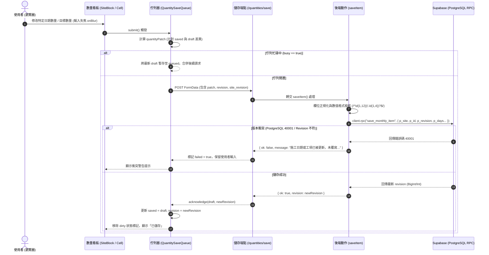
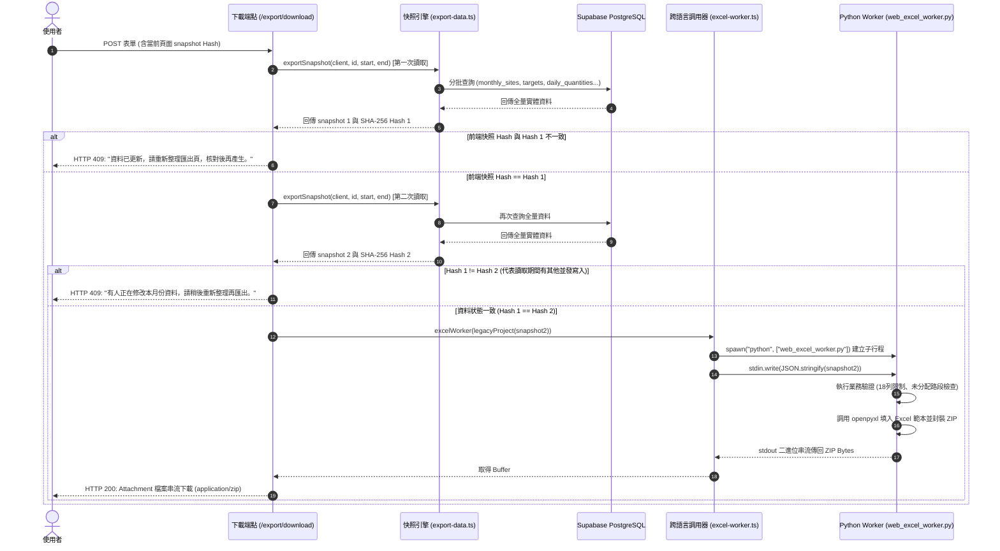

# 工程施工文件系統 (Construction Documents System) 逆向工程分析報告

> 本報告嚴格依據 `repomix-output.xml` 內之原始碼檔案事實進行逆向工程剖析，無推測或未出現在程式碼中的邏輯。

---

## 1. 資料表與實體清單 (Database & Tables)

專案後端採用 Supabase (PostgreSQL)，多數寫入行為透過資料庫預存程序 (RPC) 保障樂觀鎖與關聯一致性，讀取則透過 PostgREST Client 進行關聯查詢。

### 1.1 核心實體結構對照表

| 資料表名稱 (Table / View) | 欄位名稱 (Fields) | 型態 (Type) | 鍵值與約束 (PK / FK / Constraints) | 關聯性 (Relations) | 對應代碼檔案路徑 |
| :--- | :--- | :--- | :--- | :--- | :--- |
| **`organizations`** | `id`<br>`name` | `uuid`<br>`text` | **PK**: `id` | 1:N 關聯至 `projects`<br>1:N 關聯至 `organization_members` | `web/app/projects/page.tsx` |
| **`organization_members`** | `org_id`<br>`user_id`<br>`role` | `uuid`<br>`uuid`<br>`text` | **FK**: `org_id` $\to$ `organizations.id`<br>**FK**: `user_id` $\to$ `auth.users.id` | 檢查使用者組織成員權限 (RBAC) | `web/app/projects/page.tsx`<br>`web/app/projects/[id]/page.tsx` |
| **`projects`** | `id`<br>`org_id`<br>`code`<br>`name`<br>`kind`<br>`owner`<br>`contractor`<br>`supervisor`<br>`location`<br>`contract_amount`<br>`revision`<br>`archived_at` | `uuid`<br>`uuid`<br>`text`<br>`text`<br>`text`<br>`text`<br>`text`<br>`text`<br>`text`<br>`numeric`<br>`bigint / integer`<br>`timestamp with time zone` | **PK**: `id`<br>**FK**: `org_id` $\to$ `organizations.id`<br>**Unique**: `(org_id, code)`<br>**Check**: `kind IN ('park', 'rainwater')`<br>**Check**: `revision >= 1` | 1:N 關聯至 `reporting_periods`<br>1:N 關聯至 `work_orders`<br>1:N 關聯至 `project_members`<br>1:N 關聯至 `contract_versions` | `web/app/projects/actions.ts`<br>`web/lib/export-data.ts`<br>`web/app/projects/[id]/sites/actions.ts` |
| **`project_members`** | `project_id`<br>`user_id`<br>`role` | `uuid`<br>`uuid`<br>`text` | **FK**: `project_id` $\to$ `projects.id`<br>**FK**: `user_id` $\to$ `auth.users.id` | 檢查使用者標案操作權限 | `web/app/projects/[id]/page.tsx`<br>`web/app/projects/[id]/sites/page.tsx` |
| **`project_settings_view`** *(View)* | `id`<br>`name`<br>`owner`<br>`contractor`<br>`supervisor`<br>`location`<br>`contract_amount`<br>`revision` | `uuid`<br>`text`<br>`text`<br>`text`<br>`text`<br>`text`<br>`numeric`<br>`bigint` | 映射自 `projects` 表的唯讀/設定視圖 | 標案設定檢視 | `web/app/projects/[id]/page.tsx` |
| **`reporting_periods`** | `id`<br>`project_id`<br>`roc_year`<br>`month`<br>`period_start`<br>`period_end`<br>`closed_at` | `uuid`<br>`uuid`<br>`integer`<br>`integer`<br>`date`<br>`date`<br>`timestamp with time zone` | **PK**: `id`<br>**FK**: `project_id` $\to$ `projects.id`<br>**Unique**: `(project_id, period_start)`<br>**Check**: `month BETWEEN 1 AND 12` | 1:N 關聯至 `monthly_sites`<br>1:N 關聯至 `item_period_targets`<br>1:N 關聯至 `opening_balances` | `web/lib/export-data.ts`<br>`web/app/projects/[id]/prior/actions.ts` |
| **`monthly_sites`** | `id`<br>`project_id`<br>`period_id`<br>`item_number`<br>`name`<br>`work_dates`<br>`note`<br>`case_override`<br>`revision`<br>`display_order` | `uuid`<br>`uuid`<br>`uuid`<br>`integer`<br>`text`<br>`text`<br>`text`<br>`text`<br>`integer`<br>`integer` | **PK**: `id`<br>**FK**: `project_id` $\to$ `projects.id`<br>**FK**: `period_id` $\to$ `reporting_periods.id`<br>**Unique**: `(period_id, item_number)`<br>**Check**: `case_override IN ('normal', 'independent')` | 1:N 關聯至 `item_period_targets`<br>1:1 / 1:N 與派工單路段映射 | `web/app/projects/[id]/sites/actions.ts`<br>`web/lib/export-data.ts`<br>`specs/001-quantities-work-dates-sync/data-model.md` |
| **`work_orders`** | `id`<br>`project_id`<br>`number`<br>`title`<br>`issued_on`<br>`due_on`<br>`status`<br>`case_override`<br>`revision` | `uuid`<br>`uuid`<br>`text`<br>`text`<br>`date`<br>`date`<br>`text`<br>`text`<br>`integer` | **PK**: `id`<br>**FK**: `project_id` $\to$ `projects.id`<br>**Unique**: `(project_id, number)`<br>**Check**: `status IN ('draft', 'active', 'closed')`<br>**Check**: `due_on >= issued_on` | 1:N 關聯至 `work_order_items`<br>可透過 `assign_work_order_to_month` 指派至月路段 | `web/app/projects/[id]/work-orders/actions.ts`<br>`web/app/projects/[id]/work-orders/page.tsx` |
| **`contract_items`** | `code`<br>`name`<br>`unit`<br>`price`<br>`kind` | `text`<br>`text`<br>`text`<br>`numeric`<br>`text` | **PK**: `code`<br>**Check**: `kind IN ('park', 'rainwater')` | 基礎工項目錄與單價對照 | `web/lib/export-data.ts`<br>`web/lib/legacy-catalog.json` |
| **`work_order_items`** | `id`<br>`work_order_site_id`<br>`contract_item_code` | `uuid`<br>`uuid`<br>`text` | **PK**: `id`<br>**FK**: `contract_item_code` $\to$ `contract_items.code` | 派工路段與合約工項中繼關聯 | `web/lib/export-data.ts` |
| **`item_period_targets`** | `id`<br>`project_id`<br>`period_id`<br>`site_id`<br>`work_order_item_id`<br>`target_quantity`<br>`note`<br>`revision` | `uuid`<br>`uuid`<br>`uuid`<br>`uuid`<br>`uuid`<br>`numeric(12, 4)`<br>`text`<br>`integer` | **PK**: `id`<br>**FK**: `project_id` $\to$ `projects.id`<br>**FK**: `period_id` $\to$ `reporting_periods.id`<br>**FK**: `site_id` $\to$ `monthly_sites.id`<br>**FK**: `work_order_item_id` $\to$ `work_order_items.id` | 1:N 關聯至 `daily_quantities` | `web/app/projects/[id]/quantities/actions.ts`<br>`web/lib/export-data.ts` |
| **`daily_quantities`** | `id`<br>`project_id`<br>`target_id`<br>`work_date`<br>`quantity` | `uuid`<br>`uuid`<br>`uuid`<br>`date`<br>`numeric(12, 4)` | **PK**: `id`<br>**FK**: `project_id` $\to$ `projects.id`<br>**FK**: `target_id` $\to$ `item_period_targets.id`<br>**Unique**: `(target_id, work_date)` | 記錄當月單一路段工項在特定日期的實際施作數量 | `web/lib/export-data.ts`<br>`web/app/projects/[id]/quantities/actions.ts` |
| **`opening_balances`** | `id`<br>`project_id`<br>`period_id`<br>`contract_item_code`<br>`as_of_date`<br>`quantity`<br>`revision` | `uuid`<br>`uuid`<br>`uuid`<br>`text`<br>`date`<br>`numeric(16, 6)`<br>`integer` | **PK**: `id`<br>**FK**: `project_id` $\to$ `projects.id`<br>**FK**: `period_id` $\to$ `reporting_periods.id`<br>**FK**: `contract_item_code` $\to$ `contract_items.code` | 記錄截至該期程前一日的前期累計施作量 | `web/app/projects/[id]/prior/actions.ts`<br>`web/lib/export-data.ts` |
| **`contract_versions`** | `id`<br>`project_id`<br>`label`<br>`amount`<br>`effective_date` | `uuid`<br>`uuid`<br>`text`<br>`numeric`<br>`date` | **PK**: `id`<br>**FK**: `project_id` $\to$ `projects.id` | 記錄標案契約金額變更歷程 | `web/lib/export-data.ts` |

---

## 2. 核心函式與進入點清單 (Functions & Endpoints)

系統入口分為 **Next.js App Router API 路由 (`route.ts`)** 與 **伺服器動作 (Server Actions, `actions.ts`)**，另由後端內部模組負責資料匯出與 Python Worker 行程調用。

### 2.1 API 路由 (Route Handlers)

| 檔案路徑 | 進入點 / HTTP Method | 輸入參數與型態 | 回傳格式 | 操作資料表與 CRUD 行為 |
| :--- | :--- | :--- | :--- | :--- |
| `web/app/download/[key]/route.ts` | `GET` | `params: { key: string }` (`log` \| `settlement` \| `json`) | `Binary (xlsx / json)` | **None (無 DB 操作)**<br>讀取本機 `.local-data/` 靜態檔案，供 `local-preview` 模式比對校驗。 |
| `web/app/projects/[id]/export/download/route.ts` | `POST` | `params: { id: string }`<br>`FormData: { year, month, snapshot }` | `application/zip` (ZIP 檔二進位串流) 或 `JSON { message }` | **R**: `projects`, `reporting_periods`, `monthly_sites`, `item_period_targets`, `daily_quantities`, `opening_balances`, `contract_versions`<br>進行雙重快照比對後送入 Python Worker 產出 Excel。 |
| `web/app/projects/[id]/quantities/save/route.ts` | `POST` | `FormData`: `site`, `id`, `revision`, `site_revision`, `target`, `note`, `day:*`, `operation` | `JSON { ok: boolean, message: string, revision?: number }` | **R/U/D**: 委派至 `saveItem()` 執行同源檢查與 RPC `save_monthly_item`。 |

### 2.2 伺服器動作 (Server Actions)

| 檔案路徑 | 函式名稱 | 輸入參數與型態 | 回傳格式 | 操作資料表與 CRUD 行為 |
| :--- | :--- | :--- | :--- | :--- |
| `web/app/login/actions.ts` | `login` | `previous: LoginState`<br>`form: FormData` (`email`, `password`) | `Promise<LoginState>` (成功時 redirect) | **R/Auth**: 呼叫 Supabase Auth `signInWithPassword` 建立 Session。 |
| `web/app/login/actions.ts` | `logout` | 無 | `Promise<void>` (redirect `/login`) | **Auth**: 呼叫 Supabase Auth `signOut({ scope: "local" })`。 |
| `web/app/projects/actions.ts` | `createProject` | `_previous: FormState`<br>`form: FormData` (`org_id`, `code`, `name`, `kind`) | `Promise<FormState>` (成功時 redirect) | **C**: 呼叫 RPC `create_project`<br>建立 `projects` 記錄並建立預設期程/權限。 |
| `web/app/projects/actions.ts` | `saveSettings` | `previous: FormState`<br>`form: FormData` (`id`, `revision`, `name`, `owner`, `contractor`, `supervisor`, `location`, `amount`) | `Promise<FormState>` | **U**: 呼叫 RPC `save_project_settings`<br>帶入 `p_revision` 樂觀鎖更新 `projects` 基本屬性。 |
| `web/app/projects/[id]/sites/actions.ts` | `reorderSites` | `project: string`<br>`year: number`<br>`month: number`<br>`expected: string[]`<br>`ordered: string[]` | `Promise<{ message: string }>` | **U**: 呼叫 RPC `reorder_monthly_sites`<br>批次更新 `monthly_sites.display_order` 與項次。 |
| `web/app/projects/[id]/sites/actions.ts` | `saveSite` | `previous: SiteState`<br>`form: FormData` (`project`, `id`, `revision`, `item_number`, `year`, `month`, `name`, `work_dates`, `note`, `case_override`) | `Promise<SiteState>` | **R**: 查詢 `projects.kind`<br>**C/U**: 呼叫 RPC `save_monthly_site`<br>驗證日期間隔後新增或依 `revision` 樂觀更新 `monthly_sites`。 |
| `web/app/projects/[id]/sites/actions.ts` | `assignOrder` | `previous: { message: string, ok?: boolean }`<br>`form: FormData` (`project`, `order`, `revision`, `year`, `month`, `work_dates`) | `Promise<{ message: string, ok?: boolean }>` | **R**: 查詢 `projects.kind`<br>**C/U**: 呼叫 RPC `assign_work_order_to_month`<br>將 `work_orders` 關聯轉換並寫入 `monthly_sites`。 |
| `web/app/projects/[id]/work-orders/actions.ts` | `saveOrder` | `previous: OrderState`<br>`form: FormData` (`project`, `id`, `revision`, `number`, `title`, `status`, `case_override`, `issued_on`, `due_on`) | `Promise<OrderState>` | **C/U**: 呼叫 RPC `save_work_order`<br>校驗起迄日合法性後新增或依 `revision` 更新 `work_orders`。 |
| `web/app/projects/[id]/quantities/actions.ts` | `addItem` | `previous: QuantityState`<br>`form: FormData` (`site`, `code`) | `Promise<QuantityState>` | **R**: 查詢 `monthly_sites.project_id` 與 `projects.kind`<br>**C**: 呼叫 RPC `add_monthly_item`，載入 `legacy-catalog.json` 建立 `item_period_targets`。 |
| `web/app/projects/[id]/quantities/actions.ts` | `saveItem` | `previous: QuantityState`<br>`form: FormData` (`site`, `id`, `revision`, `site_revision`, `target`, `note`, `day:*`, `operation`) | `Promise<QuantityState>` | **R**: 若缺省略值則讀取 `item_period_targets`<br>**U/D**: 呼叫 RPC `save_monthly_item`，更新 `item_period_targets`、批次覆寫 `daily_quantities` 或執行軟刪除 (`p_remove`)。 |
| `web/app/projects/[id]/prior/actions.ts` | `savePrior` | `previous: PriorState`<br>`form: FormData` (`period`, `revision`, `codes`, `quantities`) | `Promise<PriorState>` | **R**: 查詢 `reporting_periods` 與 `projects.kind`<br>**U/C**: 呼叫 RPC `save_prior_balances`<br>解析剪貼簿矩陣後批次更新 `opening_balances`。 |

### 2.3 核心服務與背景 Worker 進入點

| 檔案路徑 | 函式名稱 | 輸入參數與型態 | 回傳格式 | 功能與操作行為 |
| :--- | :--- | :--- | :--- | :--- |
| `web/lib/export-data.ts` | `exportSnapshot` | `client: SupabaseClient`<br>`projectId: string`<br>`start: string`<br>`end: string` | `Promise<{ snapshot: object, hash: string }>` | 分頁批次（每批 500 筆）取出該標案月份所有路段、工項目標、每日數量與前期餘額，計算整體 SHA-256 雜湊。 |
| `web/lib/excel-worker.ts` | `excelWorker` | `project: any` (標準化快照物件) | `Promise<Buffer>` (ZIP 二進位資料) | 透過 `child_process.spawn` 啟動 Python Worker，經由 `stdin` 傳入 JSON，從 `stdout` 接收產生之 Excel ZIP 檔。 |
| `migration_tools/web_excel_worker.py` | `generate` | `data: dict` (自 `sys.stdin` 讀取之 JSON 快照) | `bytes` (ZIP 二進位流) | 呼叫原始 `baselines` 模組中的 `export_log_only` 與 `export_settlement_for_sites`，利用 `openpyxl` 產出施工日誌與結算報表。 |
| `web/lib/quantity-save-queue.ts` | `QuantitySaveQueue.submit` | `remove = false`<br>`force = false` | `Promise<void>` | 前端按行維護的佇列管理器。計算 `quantityPatch` 差異量，向後端發送更新，成功後才遞增行版本號 (`revision`)。 |

---

## 3. 系統架構與資料流 (Architecture)

### 3.1 數量即時編輯與樂觀鎖保存資料流 (Mermaid 循序圖)

此圖展示使用者在前端數量看板 (Quantity Board) 編輯數據時，透過前端差量佇列 (`QuantitySaveQueue`) 搭配後端樂觀版本號進行並發控制的完整流程：



---

### 3.2 報表匯出雙重快照與跨語言調用流程 (Mermaid 循序圖)

此圖呈現報表匯出時為防止讀寫衝突所採取的 **Double-Read Hash Verification (雙重快照校驗)**，以及 Node.js 與 Python 行程之間的資料傳遞：



---

## 4. 代碼事實中的技術債與強耦合風險點分析

### 4.1 行程級跨語言強耦合 (IPC via Child Process)
* **代碼事實**：`web/lib/excel-worker.ts` 第 14 行直接呼叫 `spawn(python, [worker])`，依賴本機作業系統必須安裝 Python 且具備 `openpyxl` 套件，並在第 6 行顯式宣告 `if (process.env.VERCEL) throw Error("文件服務尚未部署。");`。
* **風險與影響**：
  * **容器與環境鎖定**：無法直接在標準 Serverless 雲端平台（如 Vercel Edge / Functions）執行，必須以 Docker 容器多階段建置方式（同時包含 Node.js 與 Python）維護。
  * **行程消耗與記憶體洩漏**：每次匯出請求均會啟動一個獨立 Python 行程，高並發下載時將迅速耗盡伺服器 CPU 與 Process Table，存在 DoS 風險。

### 4.2 報表列數硬編碼限制 (Hardcoded 18 Rows Limit)
* **代碼事實**：`migration_tools/web_excel_worker.py` 第 30~31 行硬編碼限制：
  ```python
  if (kind.id == 'rainwater' and len(normal) > 18) or (kind.id == 'park' and len(project.sites) > 18):
      raise ValueError('本次路段超過原範本 18 列，需先確認分頁方式，避免漏列。')
  ```
* **風險與影響**：
  * **業務阻斷**：當單一工程標案在單月份的路段數超過 18 筆時，匯出功能將直接拋出錯誤並中斷，無動態分頁或範本擴展機制。

### 4.3 雙重快照樂觀檢查的併發盲區 (Time-of-Check to Time-of-Use, TOCTOU)
* **代碼事實**：`web/app/projects/[id]/export/download/route.ts` 第 38~49 行透過連續執行兩次 `exportSnapshot` 計算 SHA-256 比對一致性。
* **風險與影響**：
  * 此機制為應用層模擬的一致性讀取，並未在 PostgreSQL 啟用真正的可序列化交易隔離層 (`SERIALIZABLE` Transaction Isolation)。
  * 在第二次讀取完成後到 Python Worker 產出 Excel 的這段時間內，若有寫入動作，匯出的 Excel 內容依然可能包含不一致的狀態。

### 4.4 資料庫型態與客戶端型態分散維護 (Split Source of Truth)
* **代碼事實**：
  * 前端手動在 `web/lib/types.ts` 定義 `Site`, `Record`, `Total`, `Snapshot`。
  * 後端在 PostgreSQL 透過 RPC 運算（如 `save_monthly_item`, `create_project`）。
  * Python Worker 在 `baselines/20260920T151632Z/source/app/models.py` 另以 Python `dataclass` 定義 `Project`, `Site`, `Quantity`。
* **風險與影響**：
  * 未使用 Supabase CLI 自動從 DB Schema 產出 TypeScript 型別定義。
  * 任何資料表結構調整，需同步手動修改 TypeScript、PostgreSQL RPC 與 Python Dataclass，極易引發欄位不對齊錯誤。

### 4.5 業務邏輯深陷資料庫預存程序 (Database Stored Procedure Lock-in)
* **代碼事實**：全系統的核心邏輯（包含項次重新編號、日期間隔格式校驗、關閉狀態判定、版本遞增 `revision + 1`、歷史前期量計算等）全數封裝於 PostgreSQL RPC 內（如 `save_monthly_item`, `reorder_monthly_sites`, `save_prior_balances`）。
* **風險與影響**：
  * 專案儲存庫中未見 SQL 原始遷移檔（Migration scripts）版本化管理，造成邏輯黑箱。
  * 業務單元測試困難，無法在純前端或無連線狀態下單獨對業務規則進行單元測試（需依賴 Mock 或連線至真實 Supabase 實例）。
