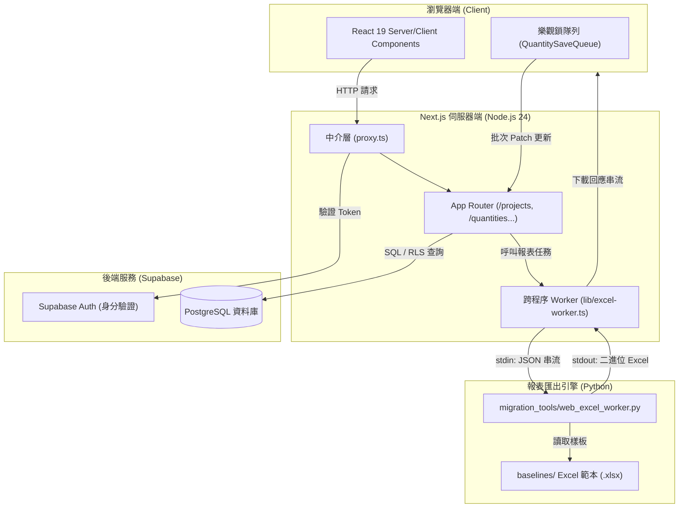
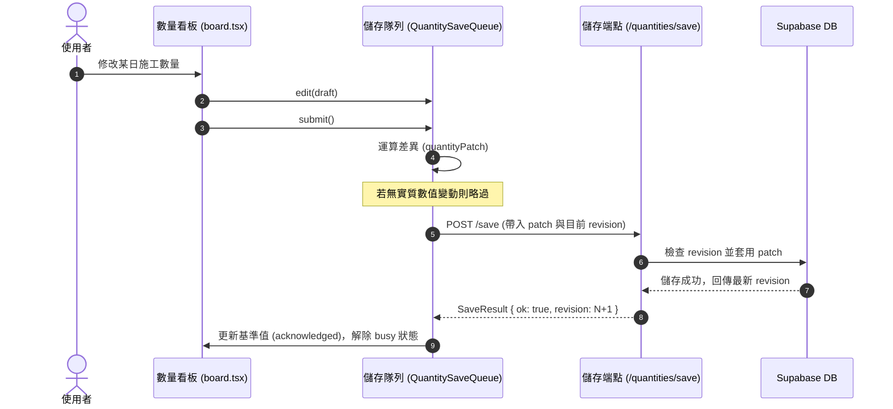
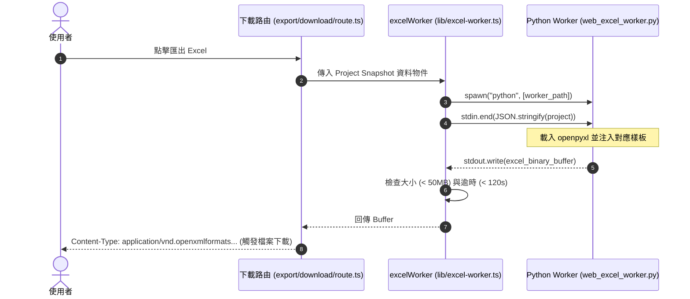

# Web 模組架構說明書 (工程師指南)

本文件專為接手此專案的工程師撰寫，旨在說明 `web/` 的系統架構、業務領域模型、前後端通訊機制與核心演算法。

---

## 1. 系統定位與領域背景

本系統為 **台灣公共工程施工文件管理系統**，主要支援兩大工程類型：
* **公園工程（Park）**：期程最小月份為 2 月。
* **雨水下水道工程（Rainwater）**：期程最小月份為 4 月。

核心目標是將繁複的工區（Sites）、派工單（Work Orders）、每日施工數量（Daily Quantities）與前期累計（Prior Accumulation）自動化轉換為符合政府審核規範的 **施工日誌** 與 **結算驗收 Excel 報表**。

---

## 2. 系統架構拓撲圖

系統由前端 UI、Next.js Server、Supabase BaaS 與底層 Python Excel 報表引擎三層組成：



---

## 3. 關鍵資料流程與循序圖

### 3.1 數量編輯與樂觀鎖保存隊列 (QuantitySaveQueue)

為了防止工程師在表格中連續輸入數量時發生資料競爭或覆蓋，前端實作了版本修訂號（Revision）與差異補丁（Patch）隊列機制：



### 3.2 跨語言 Excel 報表匯出機制

Next.js 本身不依賴肥大的 Node.js Excel 庫，而是將已標準化的標案 JSON 資料透過 IPC 送給獨立 Python Worker 處理：



---

## 4. 目錄結構與職責說明

```
web/
├── app/                              # Next.js App Router 頁面與 API
│   ├── layout.tsx                    # 全域佈局
│   ├── page.tsx                      # 首頁 (依模式導向 /projects 或展示 legacy-preview)
│   ├── proxy.ts                      # 路由中介軟體 (Middleware，負責更新 Supabase Cookie)
│   ├── login/                        # 登入模組 (Supabase Auth 串接)
│   │   ├── actions.ts                # 登入與登出 Server Actions
│   │   ├── form.tsx                  # 登入表單元件
│   │   └── page.tsx                  # 登入頁 (具備連線檢測機制)
│   └── projects/                     # 標案管理主系統
│       ├── page.tsx                  # 標案列表與新案建立 (含組織權限判定)
│       └── [id]/                     # 單一標案工作區
│           ├── page.tsx              # 標案資訊總覽看板
│           ├── sites/                # 工區管理 (工區名稱、施工期程、派工分配)
│           ├── work-orders/          # 派工單 (開工日、估驗區間、備註)
│           ├── quantities/           # 每日數量看板 (數量填報、累計即時計算)
│           │   ├── board.tsx         # 核心數量編輯看板元件
│           │   └── save/route.ts     # 接收補丁並持久化儲存的 API
│           ├── prior/                # 前期累計 (文字表格貼上解析與驗證)
│           └── export/               # 施工日誌與結算驗收 Excel 報表匯出
├── lib/                              # 業務核心邏輯層
│   ├── config.ts                     # 環境變數載入與 APP_MODE 模式判定
│   ├── excel-worker.ts               # Python 子程序呼叫與串流管理
│   ├── export-data.ts                # 標案資料結構化整理 (供匯出使用)
│   ├── prior-paste.ts                # 剪貼簿前期資料解析器 (支援 Excel 表格直接貼上)
│   ├── quantity-math.ts              # 金額與數量截斷計算 (floor2 規則)
│   ├── quantity-save-queue.ts        # 樂觀鎖版本控制與 Patch 隊列
│   ├── reporting-period.ts           # 民國年期程解析與日期區間換算
│   ├── types.ts                      # 系統 TypeScript 型別定義
│   └── supabase/                     # Supabase 連線封裝
│       ├── server.ts                 # 伺服器端客戶端 (SSR Cookie 管理)
│       └── session.ts                # 使用者身分安全驗證 (requireUser)
└── tests/                            # 核心邏輯單元測試 (數量隊列、計量運算)
```

---

## 5. 核心演算法與領域規範

### 5.1 民國年與期程計算 (`lib/reporting-period.ts`)
* 台灣公部門一律採用民國曆，系統透過 `rocYear + 1911` 換算為西元年。
* 自動依月份與年份算出當月第一天與最後一天：
  `start: YYYY-MM-01` 至 `end: YYYY-MM-DD`。

### 5.2 金額截斷規範 (`lib/quantity-math.ts`)
* 依據工程預算會計準則，金額計算採用**向下取至小數點後兩位（無條件捨去）**，不得四捨五入：
  $$\text{Amount} = \frac{\lfloor \text{Quantity} \times \text{Price} \times 100 \rfloor}{100}$$

### 5.3 樂觀鎖差異演算法 (`lib/quantity-save-queue.ts`)
* 前端比對 `saved`（後端已確認版本）與 `draft`（目前使用者畫面數值）。
* 僅針對異動的欄位產生 `patch`：
  ```typescript
  if (!equalQuantity(saved.target, draft.target)) patch.target = draft.target || '0';
  for (const day of modifiedDays) patch.days[day] = draft.days[day] || '0';
  ```
* 請求失敗時保留未儲存狀態，防止使用者輸入之工程數據遺失。

---

## 6. 本機開發須知

* **環境變數檔**：請在 `web/.env.local` 設置：
  * `APP_MODE=supabase`
  * `NEXT_PUBLIC_SUPABASE_URL`
  * `NEXT_PUBLIC_SUPABASE_PUBLISHABLE_KEY`
* **伺服器啟動**：
  * 執行 `pnpm dev`
  * 存取網址：`http://127.0.0.1:3100`
* **套件管理**：
  * 套件更新與安裝一律使用 `pnpm` 以維護 `pnpm-lock.yaml` 的完整性。
